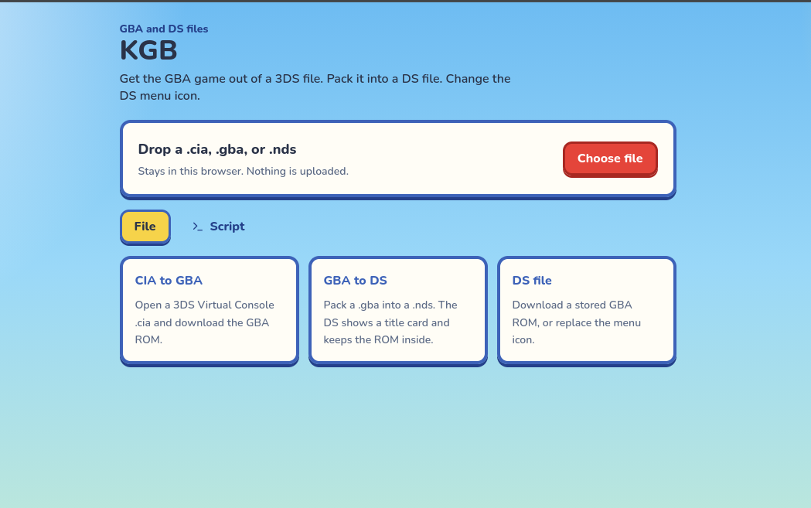

</p>
<div align="center">

## KGB

**GBA ROMs out of 3DS Virtual Console `.cia` files, packed into DS `.nds` files, all in your browser.**

</div>

Get a GBA ROM out of a Nintendo 3DS Virtual Console `.cia`, pack that ROM into a Nintendo DS `.nds`, or change the icon on a DS file.

Files stay in the browser. Nothing is uploaded.



## What you can do

- **CIA to GBA.** Drop a NoCrypto `.cia` from a GBA Virtual Console inject. KGB strips the AGB_FIRM boot preamble and the `.CAA` footer and gives you the `.gba`.
- **GBA to DS.** Pack a `.gba` into a `.nds`. The DS shows a title card. The original ROM is stored inside as `rom.gba`. A DS does not run the GBA game by itself.
- **DS to GBA.** If a GBA ROM is stored in the `.nds`, download it unchanged.
- **Menu icon.** Put a picture on the DS banner (header `+0x68`). It is reduced to 32×32 and 16 colors.
- - **GBA to CIA.** KGB does not build `.cia` files. Use an established injector such as NSUI or vcoven.

Save type, clock, and a few header fields are shown with the file. Offsets and the raw footer are under **Save config and offsets**.

Use files you are allowed to have. Do not share ROMs you do not own.

## Run the site

You need Node.js 22.

```
git clone https://github.com/tahaenasraoui-debug/kgb.git
cd kgb
npm install
npm run dev
```

Open `http://localhost:8080`.

Build:

```
npm run build
```

`npm run build` produces a server build in `.vercel/output`, not a static folder. It cannot be dropped onto GitHub Pages as is. Preview it with `npx vite preview`.

## License

MIT. See [LICENSE](LICENSE).
