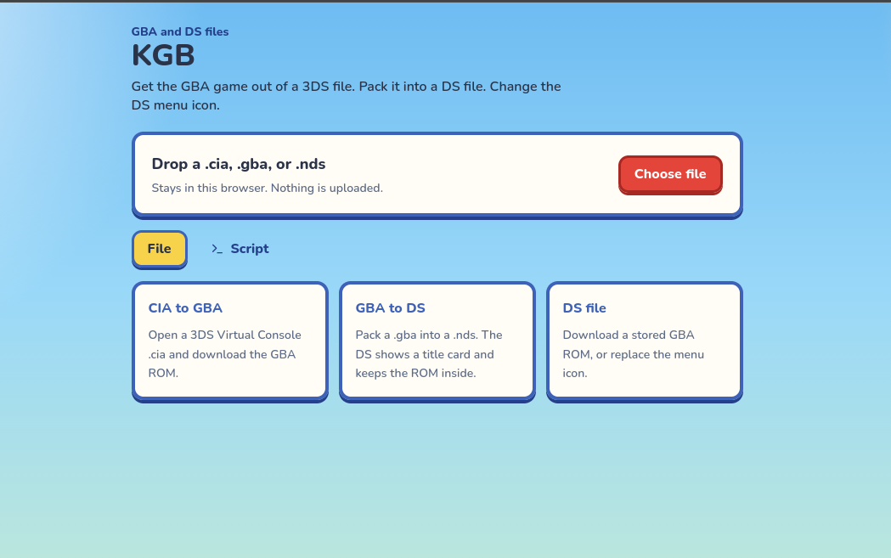

<div align="center">

## KGB

**GBA ROMs out of 3DS Virtual Console `.cia` files, packed into DS `.nds` files, all in your browser.**

[](https://github.com/tahaenasraoui-debug/kgb/actions/workflows/ci.yml)
[](https://kgb-theta.vercel.app)
[](LICENSE)

</div>

Get a GBA ROM out of a Nintendo 3DS Virtual Console `.cia`, pack that ROM into a Nintendo DS `.nds`, or change the icon on a DS file.

Files stay in the browser. Nothing is uploaded.

**Live App:** [kgb-theta.vercel.app](https://kgb-theta.vercel.app)



## What you can do

- **CIA to GBA.** Drop a NoCrypto `.cia` from a GBA Virtual Console inject. KGB strips the AGB_FIRM boot preamble and the `.CAA` footer and gives you the `.gba`.
- **GBA to DS.** Pack a `.gba` into a `.nds`. The DS shows a title card. The original ROM is stored inside as `rom.gba`. A DS does not run the GBA game by itself.
- **DS to GBA.** If a GBA ROM is stored in the `.nds`, download it unchanged.
- **Menu icon.** Put a picture on the DS banner (header `+0x68`). It is reduced to 32×32 and 16 colors.
- **GBA to CIA.** KGB does not build `.cia` files. Use an established injector such as NSUI or vcoven.

Save type, clock, and a few header fields are shown with the file. Offsets and the raw footer are under **Save config and offsets**.

Use files you are allowed to have. Do not share ROMs you do not own.

## Run the site

You need Node.js 22.

```bash
git clone https://github.com/tahaenasraoui-debug/kgb.git
cd kgb
npm install
npm run dev
```

Open `http://localhost:8080`.

Build and preview:

```bash
npm run build
npm run preview
```

`npm run build` produces a server build in `.vercel/output`, not a static folder. It cannot be dropped onto GitHub Pages as is. Preview it with `npm run preview`.

## Python CLI (`public/kgb.py`)

`public/kgb.py` runs the CIA-to-GBA extraction step from the terminal using only the Python 3 standard library (no third-party packages). DS `.nds` packing and banner icon editing remain in the web app.

```bash
# Extract the .gba ROM, .caa.json metadata, .caa.bin raw footer, and 48x48 .png icon
python3 public/kgb.py game.cia -o ./out

# Drop trailing 0xFF padding from the extracted .gba
python3 public/kgb.py game.cia -o ./out --trim-ff

# Generate a synthetic test .cia
python3 public/kgb.py --synth sample.cia

# Run the built-in synthetic CIA and BLZ round-trip self-test
python3 public/kgb.py --self-test
```

## License

MIT. See [LICENSE](LICENSE).
